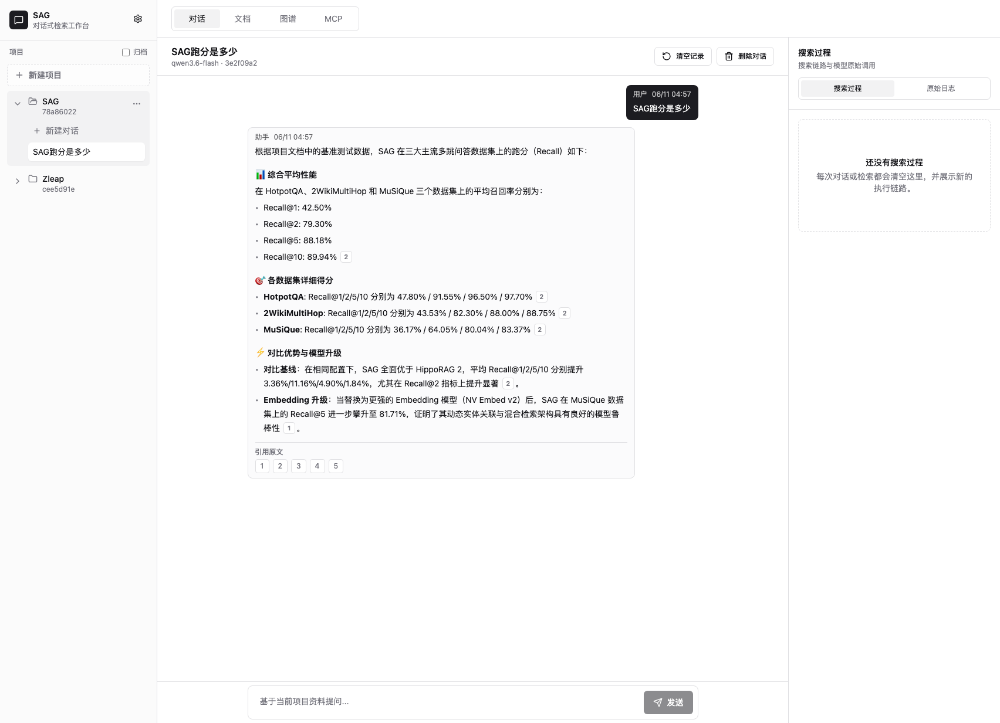
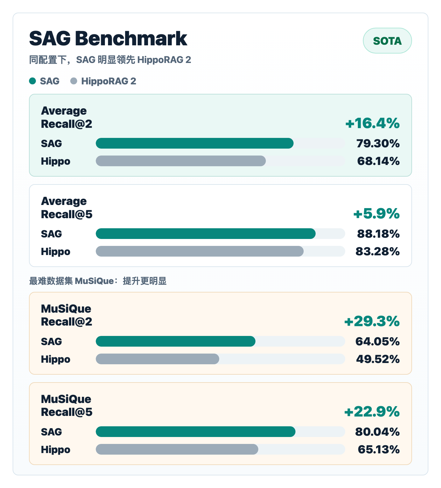
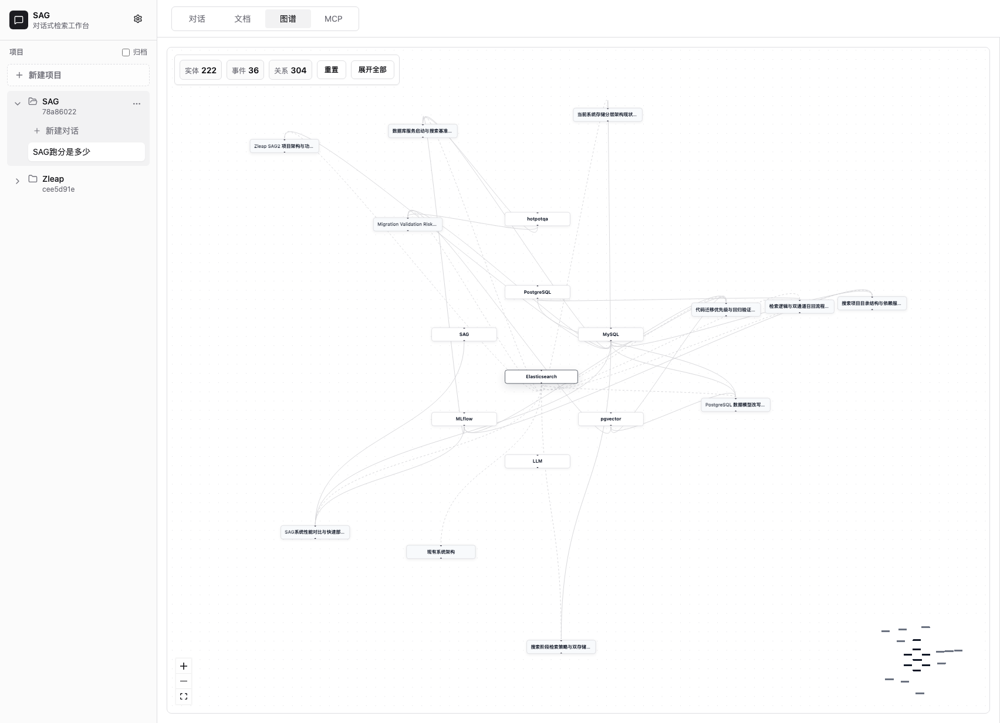

# 芯化和云化工产业链知识超图问答系统

> [!CAUTION]
> **商业机密 / 仅限内部使用**
>
> 本项目作为整体，以及其中由芯化和云形成的定制源代码、配置、数据、文档、界面设计和业务逻辑，均属于**芯化和云公司的商业机密**。  
> 未经芯化和云书面许可，禁止向公司外部人员披露、复制、传播、上传、演示、出售或用于其他项目。  
> 请勿将本项目、截图、数据库内容、API Key 或业务资料提交到公开代码仓库、公开网盘、论坛或第三方 AI 服务。

**语言**：简体中文 | [English](README.md)

本项目是**芯化和云的化工产业链知识超图问答系统**，未来可作为知识能力模块内置到公司的 **ChemClaw** 产品中。

系统底层使用 SAG 图谱检索技术。上传 Markdown / TXT 文档后，系统会自动完成切片、向量化、事件提取、实体提取和关系整理。用户可以围绕化工产品、原料、工艺、企业、产能及上下游关系连续提问，也可以查看知识资产、事件、实体、Embedding、推理链路和知识超图。

主要页面：

- **智能问答**：基于当前知识空间进行化工产业链问答。
- **知识资产**：上传和管理文档，查看切片、事件、实体及向量化结果。
- **知识超图**：查看企业、产品、原料、工艺和产业事件之间的关系。
- **ChemClaw 接入**：通过 MCP 将当前知识空间提供给 ChemClaw 或其他内部 Agent。
- **系统设置**：配置 LLM、Embedding、检索模式和界面语言。



## 小白启动指南

下面以 **Windows + PowerShell + Docker Desktop** 为例。命令需要在本项目根目录执行，也就是能看到 `package.json` 和 `docker-compose.yml` 的文件夹。

### 启动前需要安装

电脑上需要有：

1. [Node.js](https://nodejs.org/) 20 或更高版本。安装 Node.js 后会同时安装 npm。
2. [Docker Desktop](https://www.docker.com/products/docker-desktop/)，用于运行 PostgreSQL 和 pgvector。
3. Chrome、Edge 等现代浏览器。

安装完成后，先启动 Docker Desktop，等待其显示 Docker Engine 正常运行。

可以在 PowerShell 中检查 Node.js 和 npm：

```powershell
node --version
npm --version
```

只要命令能显示版本号即可。

### 第一次启动

#### 第 1 步：进入项目目录

最简单的方法是在 Windows 文件资源管理器中打开本项目文件夹，然后在地址栏输入 `powershell` 并按回车。

也可以在 PowerShell 中执行：

```powershell
Set-Location "D:\坚果云\我的坚果云\芯化和云\2026年6月\SAG-main"
```

#### 第 2 步：创建本地配置文件

如果项目根目录已经存在 `.env`，跳过这一步。

```powershell
Copy-Item .env.example .env
```

`.env` 可能包含数据库连接和模型配置，属于敏感配置，不要发送给无关人员。

#### 第 3 步：安装项目依赖

```powershell
npm install
```

这一步通常只需要在第一次启动或依赖发生变化后执行。

#### 第 4 步：启动数据库

确保 Docker Desktop 已经启动，然后执行：

```powershell
docker compose up -d
```

检查数据库状态：

```powershell
docker compose ps
```

看到 `sag_lite_postgres` 为运行或健康状态即可。

#### 第 5 步：初始化数据库

```powershell
npm run db:setup
```

数据库初始化通常只需要执行一次。以后正常启动时不要反复执行这一命令。

#### 第 6 步：启动前端和后端

```powershell
npm run dev
```

看到终端中出现类似以下地址，表示启动成功：

```text
WebUI: http://localhost:5173
API:   http://localhost:4173
```

不要关闭这个 PowerShell 窗口。打开浏览器访问：

[点击打开系统网页：http://localhost:5173](http://localhost:5173)

### 以后每次启动

以后通常只需要打开 Docker Desktop，在项目目录中依次执行：

```powershell
docker compose up -d
npm run dev
```

然后在浏览器打开：

[点击打开系统网页：http://localhost:5173](http://localhost:5173)

不需要每次都执行 `npm install` 或 `npm run db:setup`。

### 如何停止

1. 回到运行 `npm run dev` 的 PowerShell 窗口。
2. 按 `Ctrl + C` 停止前端和后端。
3. 如果还要停止数据库，可以执行：

```powershell
docker compose stop
```

`docker compose stop` 不会删除数据库数据。不要随意执行带 `down -v` 的命令，因为 `-v` 可能删除数据库数据。

### 常见问题

#### 浏览器打不开 `http://localhost:5173`

- 确认运行 `npm run dev` 的窗口没有被关闭。
- 查看终端是否出现红色错误。
- 如果 5173 端口被占用，Vite 可能会显示另一个地址，请打开终端实际显示的地址。

#### 提示无法连接数据库

先执行：

```powershell
docker compose ps
```

如果数据库没有运行，执行：

```powershell
docker compose up -d
```

#### 提示找不到 `npm`

说明 Node.js 没有正确安装，或安装后尚未重新打开 PowerShell。安装 Node.js 后关闭并重新打开终端。

#### 提示找不到 `docker`

确认 Docker Desktop 已安装并已启动。首次安装后可能需要重启电脑。

#### 页面能打开，但模型回答效果有限

未配置有效的 LLM / Embedding API Key 时，系统可能使用本地 fallback。点击左侧顶部的设置按钮，在“知识引擎与模型设置”中配置公司批准使用的模型服务。

> [!WARNING]
> 配置模型服务前必须确认该服务符合公司的数据安全要求。不得将芯化和云的保密数据发送给未经公司批准的第三方模型服务。

## RAG 领域新 SOTA

论文复现代码：[Zleap-AI/SAG-Benchmark](https://github.com/Zleap-AI/SAG-Benchmark)

SAG 是面向 Agent 的新一代 RAG 技术路线。它不靠给模型塞更多 chunk，而是用更轻量的结构重新组织文档知识：

```text
chunk -> event
chunk -> entities
event <-> entities
```

每个 chunk 提取一个完整事项 event 和多个 entities。event 保留完整语义，entities 负责索引和关系扩展，让检索可以从命中事项出发继续多跳召回，同时避免重型知识图谱的全局重建成本。


在 HotpotQA / 2WikiMultiHop / MuSiQue 上，使用相同配置：

```text
Embedding = bge-large-en-v1.5
LLM = qwen3.6-flash
Datasets = HotpotQA / 2WikiMultiHop / MuSiQue
```

SAG 对比 HippoRAG 2 在多跳问答召回上取得了明显提升：**平均 Recall@2 从 68.14% 提升到 79.30%，提升 11.16 个百分点，相对提升约 16.4%**。Recall@2 更高意味着 Agent 可以用更少上下文更早命中关键证据，减少 token 成本、延迟和多轮任务里的干扰。



在 MuSiQue Recall@5 上，SAG 从 HippoRAG 2 的 65.13% 提升到 80.04%；换用 NV-Embed-v2 后进一步达到 81.71%，说明收益主要来自结构设计，而不只是更强的 embedding 模型。

## SAG 能做什么

这个项目把 SAG 技术做成了一个可以直接运行的本地工作台，适合：

- 项目文档问答
- 个人知识库检索
- RAG / Agent 原型验证
- 文档事项和实体分析
- MCP 工具接入测试
- 检索链路调试和模型调用观察

核心功能：

- **项目管理**：每个项目拥有自己的文档、对话、图谱和 MCP 配置。
- **多文档上传**：支持一次上传多个 Markdown / TXT 文档，展示处理阶段和进度。
- **文档处理结果**：查看切片、事项、实体、Embedding 数据，支持标题关键字搜索和分页浏览。
- **离线结构化导入**：可粘贴或上传网页版 AI 生成的 CSV / Markdown / JSON，事件 UUID 由系统生成，不依赖人工连续编号。
- **项目数据导出**：可将项目内文档、切片、事件、实体和关系完整导出为 CSV 或 JSON，便于本地备份、校对和二次编辑。
- **备份回灌**：新增项目后，可从“导入 AI 表格”直接上传本项目导出的 CSV 或 JSON；多文档会分别恢复，数据库 UUID 会重新生成。
- **对话式检索**：围绕当前项目资料多轮提问，支持流式输出和停止生成。
- **引用原文**：回答里可以显示引用序号，点击查看对应原文块。
- **搜索过程可视化**：右侧面板实时展示 SAG 内部检索链路和耗时。
- **原始日志**：浏览器缓存中可查看 LLM / Embedding / Rerank 原始请求和返回。
- **知识图谱**：以实体和事项为节点查看项目关系，支持模糊搜索、输入联想、聚焦子图和问答结果联动高亮。
- **MCP 接入**：每个项目都有自己的 MCP 配置，外部 Agent 可直接调用当前项目资料。

## 技术栈

SAG 使用 TypeScript 贯穿前后端。前端是 React + Vite + Tailwind CSS 的 WebUI；后端是 Fastify HTTP API、MCP TypeScript SDK 和分层服务模块；数据层使用 PostgreSQL、pgvector、全文检索和 SQL 多跳查询；模型侧兼容 OpenAI-compatible 的 LLM、Embedding 和 Rerank 接口。

## 工作台预览

### 知识资产

在「知识资产」页可以上传文档，查看处理状态、切片、事件、实体和 Embedding。


### 知识超图

在「知识超图」页可以查看项目内实体和事件关系。节点可以拖动、缩放，点击展开，双击打开详情。



### 智能问答

在「智能问答」页可以围绕当前知识空间连续提问。每次检索都会刷新右侧推理链路，方便查看本轮知识检索过程。

## 检索模式

SAG 提供两种模式：

- **极速模式**：直接用 query 在实体库做全文 / BM25 匹配，结合 SAG 多跳扩展，最后用 `qwen3-rerank` 选择 top-k。这个模式不需要 LLM 抽 query 实体，也不需要 LLM 过滤候选，速度更快。
- **标准模式**：用 LLM 抽取 query 实体，再走 SAG 多路召回和 LLM 精排，适合对比更高精度链路。

两种模式都不是普通向量搜索，因为它们都使用 SAG 的 event/entity 索引和 SQL 多跳扩展。

## 开发者快速开始

### 1. 准备环境

你需要：

- Node.js 20 或更高版本
- npm
- PostgreSQL
- pgvector

如果你只是想最快跑起来，推荐用 Docker 启动 PostgreSQL。

### 2. 创建配置文件

```powershell
Copy-Item .env.example .env
```

`.env.example` 已经包含默认配置。真实使用时，请填入自己的 LLM 和 Embedding API Key。

### 3. 启动 PostgreSQL

使用 Docker：

```bash
docker compose up -d
```

不想用 Docker，也可以在 macOS 上用 Homebrew：

```bash
brew install postgresql@17 pgvector
brew services start postgresql@17

/opt/homebrew/opt/postgresql@17/bin/createdb sag_lite
/opt/homebrew/opt/postgresql@17/bin/psql -d sag_lite -c 'create extension if not exists vector;'
```

如果你使用本机 PostgreSQL，请把 `.env` 里的 `DATABASE_URL` 改成自己的连接地址，例如：

```env
DATABASE_URL=postgres://你的用户名@localhost:5432/sag_lite
```

### 4. 安装依赖并初始化数据库

```bash
npm install
npm run db:setup
```

### 5. 启动开发服务

```bash
npm run dev
```

开发模式默认地址：

```text
WebUI: http://localhost:5173
API:   http://localhost:4173
```

### 6. 构建并启动生产服务

```bash
npm run build
npm start
```

生产模式默认地址：

```text
http://localhost:4173
```

## 第一次怎么用

1. 打开 WebUI。
2. 在左侧知识空间列表顶部点击「新建项目」。
3. 进入「知识资产」页，点击「添加文档」。
4. 上传 `.md` 或 `.txt` 文件。
5. 等待处理队列完成。
6. 查看切片、事件、实体和 Embedding 状态。
7. 回到「智能问答」页，围绕当前知识空间提问。
8. 需要调试时，查看右侧「推理链路」和「模型日志」。
9. 需要查看关系时，进入「知识超图」页。
10. 需要接入公司内部 Agent 时，进入「ChemClaw 接入」页复制当前项目的 MCP 配置。

## 配置 LLM 和 Embedding

SAG 支持 OpenAI-compatible 接口。默认示例：

```env
EMBEDDING_BASE_URL=https://api.302ai.cn/v1
EMBEDDING_MODEL=text-embedding-3-large
EMBEDDING_DIMENSIONS=1024

LLM_BASE_URL=https://api.302ai.cn/v1
LLM_MODEL=qwen3.6-flash

RERANK_MODEL=qwen3-rerank
DEFAULT_SEARCH_MODE=fast
```

你可以通过两种方式配置：

### 方式一：WebUI 全局设置

点击左侧顶部的设置图标，进入全局设置页，填写 provider、模型名和 API Key。

API Key 只会显示“已配置 / 未配置”，不会在界面和接口响应里明文回显。

### 方式二：`.env`

```env
EMBEDDING_API_KEY=你的_embedding_key
LLM_API_KEY=你的_llm_key
```

如果没有配置 API Key，系统会使用本地 deterministic fallback，方便跑测试和看界面；真实检索效果请配置远程模型。

## MCP 接入

SAG 可以作为 MCP Server 提供给外部 Agent 使用。每个项目的 MCP 都会绑定当前项目 ID，工具调用时不需要再传 `projectId`。

在 WebUI 里进入「MCP」页，可以看到当前项目自动生成的 `mcpServers` JSON。格式类似：

```json
{
  "mcpServers": {
    "sag": {
      "command": "npm",
      "args": ["run", "mcp"],
      "env": {
        "SAG_MCP_SOURCE_ID": "当前项目ID"
      }
    }
  }
}
```

当前提供的 MCP 工具：

- `sag_ingest_document`：导入文档并执行切片、事项抽取、实体抽取和向量化。
- `sag_search`：对当前项目执行 SAG 多路检索，并返回内部检索 trace。
- `sag_explain_search`：返回当前项目的检索链路说明和 trace。
- `sag_get_event`：按事件 ID 查询事件详情。

## HTTP API 示例

健康检查：

```bash
curl http://localhost:4173/health
```

创建项目：

```bash
curl -X POST http://localhost:4173/api/projects \
  -H 'Content-Type: application/json' \
  -d '{"name":"Demo 项目"}'
```

写入文档：

```bash
curl -X POST http://localhost:4173/ingest \
  -H 'Content-Type: application/json' \
  -d '{"sourceId":"项目ID","title":"Demo","content":"# Demo\n\nSAG 可以检索项目文档。","extract":true}'
```

执行检索：

```bash
curl -X POST http://localhost:4173/api/search \
  -H 'Content-Type: application/json' \
  -d '{"query":"SAG 为什么适合多跳检索？","sourceIds":["项目ID"],"strategy":"multi","searchMode":"fast","topK":5,"returnTrace":true}'
```

流式检索过程：

```bash
curl -N -X POST http://localhost:4173/api/search/stream \
  -H 'Content-Type: application/json' \
  -d '{"query":"解释 SAG 的 event/entity 索引","sourceIds":["项目ID"],"strategy":"multi","returnTrace":true}'
```

## 常用命令

```bash
# 类型检查
npm run typecheck

# 运行测试
npm test

# 构建生产版本
npm run build

# 启动生产服务
npm start

# 启动 MCP stdio server
npm run mcp
```

## 项目结构

```text
src/
  ai/                 LLM、Embedding、Rerank 客户端
  api/                HTTP API
  config/             环境配置
  db/                 数据库连接、迁移、Repository、向量工具
  ingestion/          文档切片和事项提取
  mcp/                MCP Server
  observability/      日志和模型调用记录
  services/           文档处理、搜索、图谱、WebUI 服务

web/
  src/                React WebUI

migrations/           PostgreSQL schema
test/                 单元测试
docs/assets/          README 截图和图示资源
```

## 常见问题

### PostgreSQL 连接失败怎么办？

先确认数据库已经启动：

```bash
docker compose ps
```

再确认 `.env` 里的 `DATABASE_URL` 是否正确。

### 提示 pgvector 不存在怎么办？

请确认数据库安装了 pgvector，并执行过：

```sql
create extension if not exists vector;
```

如果使用 `docker compose up -d`，镜像已经包含 pgvector。

### 为什么没有真实模型效果？

如果没有配置 `LLM_API_KEY` 和 `EMBEDDING_API_KEY`，系统会进入本地 fallback 模式。这个模式适合测试，不适合判断真实检索质量。

### 上传后处理很慢怎么办？

文档处理会调用 Embedding 和 LLM。速度主要取决于文档数量、切片数量、模型接口速度和并发配置。可以通过 `.env` 调整：

```env
INGEST_CONCURRENCY=5
```

### 端口被占用了怎么办？

开发模式可以调整 `.env`：

```env
HTTP_PORT=4173
```

Vite WebUI 默认会使用 `5173`，如果端口被占用会自动提示新的地址。

## 知识产权与保密说明

- 本项目中的芯化和云定制代码、配置、业务数据、产品设计、提示词、接口信息及内部文档属于公司保密资产，未经书面许可不得对外提供或用于公司以外的项目。
- 本项目使用的 SAG 及其他第三方开源组件仍分别遵循其原始许可证。仓库中的 [LICENSE](LICENSE) 用于说明相关开源代码的许可来源，不代表芯化和云放弃对定制成果和商业资料的保密要求。
- 如需对外发布、部署、演示、授权或交付，必须先经过芯化和云负责人及相关合规人员审核。
