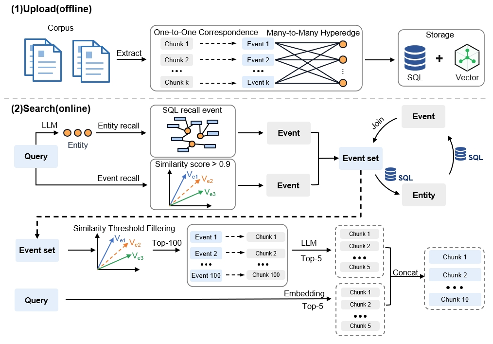
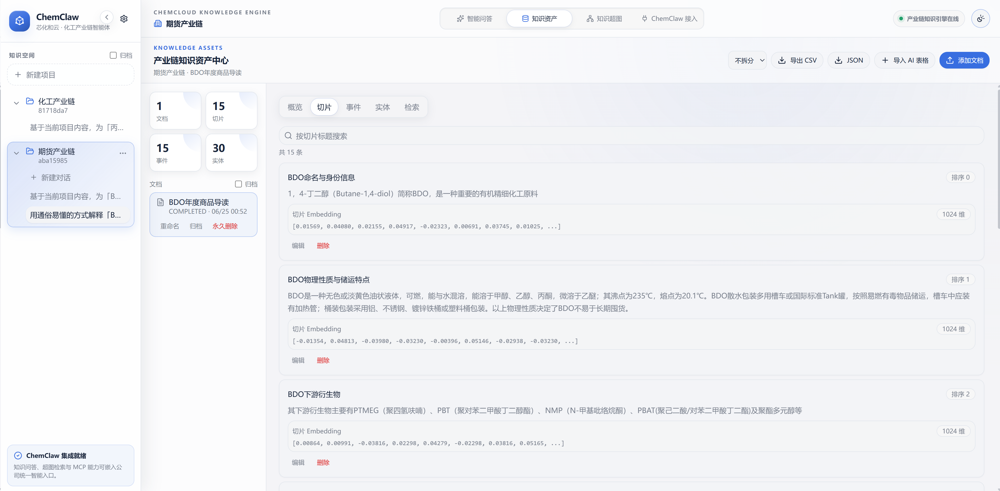

# 芯化和云化工产业链知识超图问答系统

> [!CAUTION]
> **商业机密 / 仅限内部使用**
>
> 本项目作为整体，以及其中由芯化和云形成的定制源代码、配置、数据、文档、界面设计和业务逻辑，均属于**芯化和云公司的商业机密**。  
> 未经芯化和云书面许可，禁止向公司外部人员披露、复制、传播、上传、演示、出售或用于其他项目。  
> 请勿将本项目、截图、数据库内容、API Key 或业务资料提交到公开代码仓库、公开网盘、论坛或第三方 AI 服务。

**语言**：简体中文 | [English](README.md)

本项目是**芯化和云的化工产业链知识超图问答系统**，未来可作为知识能力模块内置到公司的 **ChemClaw** 产品中。

系统底层使用 SAG 图谱检索技术。上传 Markdown / TXT 文档后，系统会自动完成切片、向量化、事件提取、实体提取和关系整理。用户可以围绕化工产品、原料、工艺、企业、产能及上下游关系连续提问，也可以查看知识资产、事件、实体、Embedding、推理链路和知识超图。

主要页面：

- **智能问答**：基于当前知识空间进行化工产业链问答。
- **知识资产**：上传和管理文档，查看切片、事件、实体及向量化结果。
- **知识超图**：查看企业、产品、原料、工艺和产业事件之间的关系。
- **ChemClaw 接入**：通过 MCP 将当前知识空间提供给 ChemClaw 或其他内部 Agent。
- **系统设置**：配置 LLM、Embedding、检索模式和界面语言。


## 小白启动指南

下面以 **Windows + PowerShell + Docker Desktop** 为例。命令需要在本项目根目录执行，也就是能看到 `package.json` 和 `docker-compose.yml` 的文件夹。

### 启动前需要安装

电脑上需要有：

1. [Node.js](https://nodejs.org/) 20 或更高版本。安装 Node.js 后会同时安装 npm。
2. [Docker Desktop](https://www.docker.com/products/docker-desktop/)，用于运行 PostgreSQL 和 pgvector。
3. Chrome、Edge 等现代浏览器。

安装完成后，先启动 Docker Desktop，等待其显示 Docker Engine 正常运行。

可以在 PowerShell 中检查 Node.js 和 npm：

```powershell
node --version
npm --version
```

只要命令能显示版本号即可。

### 第一次启动

#### 第 1 步：进入项目目录

最简单的方法是在 Windows 文件资源管理器中打开本项目文件夹，然后在地址栏输入 `powershell` 并按回车。

也可以在 PowerShell 中执行：

```powershell
Set-Location "D:\坚果云\我的坚果云\芯化和云\2026年6月\SAG-main"
```

#### 第 2 步：创建本地配置文件

如果项目根目录已经存在 `.env`，跳过这一步。

```powershell
Copy-Item .env.example .env
```

`.env` 可能包含数据库连接和模型配置，属于敏感配置，不要发送给无关人员。

#### 第 3 步：安装项目依赖

```powershell
npm install
```

这一步通常只需要在第一次启动或依赖发生变化后执行。

#### 第 4 步：启动数据库

确保 Docker Desktop 已经启动，然后执行：

```powershell
docker compose up -d
```

检查数据库状态：

```powershell
docker compose ps
```

看到 `sag_lite_postgres` 为运行或健康状态即可。

#### 第 5 步：初始化数据库

```powershell
npm run db:setup
```

数据库初始化通常只需要执行一次。以后正常启动时不要反复执行这一命令。

#### 第 6 步：启动前端和后端

```powershell
npm run dev
```

看到终端中出现类似以下地址，表示启动成功：

```text
WebUI: http://localhost:5173
API:   http://localhost:4173
```

不要关闭这个 PowerShell 窗口。打开浏览器访问：

[点击打开系统网页：http://localhost:5173](http://localhost:5173)


### 如果开启了访问口令，先用同一个地址登录

如果 `.env` 里设置了 `PUBLIC_SHARE_TOKEN` 或 `ADMIN_SHARE_TOKEN`，系统会开启分享访问保护。此时直接打开 `http://localhost:5173` 可能会看到：

```text
请求失败：401
```

这不是数据库或 Docker 出错，而是浏览器还没有登录口令。开发模式下推荐这样进入：

```text
http://localhost:5173/share-login?token=你的管理员口令
```

登录成功后，再打开：

```text
http://localhost:5173/
```

> [!IMPORTANT]
> `localhost` 和 `127.0.0.1` 在浏览器 Cookie 里是两个不同的网站。  
> 如果你用 `http://127.0.0.1:4173/share-login?...` 登录，之后又打开 `http://localhost:5173/`，浏览器不会带上刚才的登录状态，接口就会继续返回 401。  
> 所以登录地址和网页地址要统一使用 `localhost`，或者统一使用 `127.0.0.1`，不要混用。

如果你只是自己本机使用，不想要登录口令，可以把 `.env` 里的两个口令都留空或删除：

```env
PUBLIC_SHARE_TOKEN=
ADMIN_SHARE_TOKEN=
```

修改 `.env` 后需要停止并重新执行：

```powershell
npm run dev
```

### 以后每次启动

以后通常只需要打开 Docker Desktop，在项目目录中依次执行：

```powershell
docker compose up -d
npm run dev
```

然后在浏览器打开：

[点击打开系统网页：http://localhost:5173](http://localhost:5173)

不需要每次都执行 `npm install` 或 `npm run db:setup`。


### 多台电脑之间同步数据

如果你把项目放在坚果云、OneDrive、Dropbox 等同步盘里，需要注意：**同步盘通常只会同步项目代码文件，不会自动同步 Docker 里的数据库数据**。

本项目的上传数据、解析结果、向量、项目列表等主要存在 PostgreSQL 数据库中。默认的 `docker-compose.yml` 使用 Docker volume：

```yaml
volumes:
  - sag_lite_pgdata:/var/lib/postgresql/data
```

这表示数据库文件在 Docker Desktop 自己的内部空间里，不在项目目录里。因此，公司电脑上传的数据会进入公司电脑的 Docker 数据库；坚果云同步代码后，家里电脑仍然有自己的一套 Docker 数据库，所以看不到公司电脑上传的数据。

#### 推荐方案 A：同步数据库备份文件

这是最适合个人在公司电脑和家里电脑之间切换的办法。它不是网页里的 JSON 导出/导入，而是 PostgreSQL 数据库级备份，通常更快，并且不会重新解析、重新生成向量。

在有最新数据的电脑上，停止 `npm run dev` 后执行：

```powershell
npm run db:backup
```

备份文件会生成到：

```text
backups/sag_lite.dump
```

等坚果云把这个文件同步完成后，在另一台电脑上执行：

```powershell
npm run db:restore
```

恢复完成后再启动：

```powershell
npm run dev
```

> [!WARNING]
> `npm run db:restore` 会用备份覆盖当前电脑上的本地数据库。
> 如果你在家里电脑也新增了数据，但还没有备份回公司电脑，恢复时这些本地新增数据可能会被覆盖。
> 最安全的使用方式是：一台电脑作为当前工作电脑，切换电脑前先备份，等待同步完成，另一台电脑再恢复。

#### 推荐方案 B：使用一套共享 PostgreSQL 数据库

如果你希望公司电脑上传后，家里电脑立刻能看到，真正的办法是只使用同一套数据库：

1. 把 PostgreSQL 放在一台固定运行的电脑、NAS、服务器或支持 pgvector 的托管数据库上。
2. 两台电脑的 `.env` 里都把 `DATABASE_URL` 指向这同一个数据库。
3. 两台电脑只运行网页和后端，不再各自维护一套本地数据库。

这种方式最接近“自动同步”，但要注意数据库账号密码、网络访问权限和备份。

#### 不推荐：直接用同步盘同步 PostgreSQL 数据目录

不要简单地把 PostgreSQL 的原始数据目录直接放到坚果云里同步。数据库不是普通 JSON 文件，而是一堆正在变化的二进制文件。如果一台电脑还没完全停止数据库，或者同步盘只同步了一半，另一台电脑就启动数据库，可能导致数据库损坏。

除非你非常确定自己每次都会 `docker compose down`、等待同步完成、并且永远不会两台电脑同时运行，否则不要这样做。

### 如何停止

1. 回到运行 `npm run dev` 的 PowerShell 窗口。
2. 按 `Ctrl + C` 停止前端和后端。
3. 如果还要停止数据库，可以执行：

```powershell
docker compose stop
```

`docker compose stop` 不会删除数据库数据。不要随意执行带 `down -v` 的命令，因为 `-v` 可能删除数据库数据。

## 局域网 / 临时外网分享给同事试用

本节适用于下面这个场景：

```text
你自己的电脑运行项目
↓
同事打开网页试用
↓
同事可以查看、智能问答、新增/导入数据
↓
同事不能删除、归档、清空会话，也不能修改 AI 设置
```

> [!IMPORTANT]
> 这只是 MVP 试用权限，不是正式的用户注册登录系统。正式给客户长期使用时，仍建议做账号、角色、客户数据隔离、日志和用量限制。

### 1. 带权限补丁的 server.ts

带权限补丁的文件：

```text
src/api/server.ts
```

这个补丁的权限设计是：

| 身份 | 能做什么 | 不能做什么 |
|---|---|---|
| 管理员 | 全部功能 | 无 |
| 同事 / 试用用户 | 查看、智能问答、新增项目、上传/导入数据、普通编辑 | 删除、归档、清空会话、修改 AI 设置 |

### 2. 在 .env 里设置两个访问口令

打开项目根目录的 `.env` 文件，加入：

```env
PUBLIC_SHARE_TOKEN=boss-2026-demo-123456
ADMIN_SHARE_TOKEN=admin-2026-owner-abcdef
```

含义：

```text
PUBLIC_SHARE_TOKEN：给同事用
ADMIN_SHARE_TOKEN：你自己用，不能发给别人
```

实际使用时，建议把上面的示例口令改成长一点、随机一点。

### 3. 用生产模式启动项目

不要用 `npm run dev` 给同事看。建议使用生产模式，只开放一个 4173 端口。

在项目根目录执行：

```powershell
docker compose up -d
npm run build
npm start
```

看到类似下面的输出，说明启动成功：

```text
Server listening at http://127.0.0.1:4173
Server listening at http://172.30.16.1:4173
Server listening at http://192.168.110.69:4173
```

其中：

```text
http://127.0.0.1:4173
```

只能你自己的电脑打开。

类似下面这种地址：

```text
http://192.168.110.69:4173
```

才是同一个局域网里其他电脑可以尝试打开的地址。你实际看到的 IP 可能不一样，以终端输出为准。

### 4. 你自己用管理员入口

如果你的局域网地址是：

```text
http://192.168.110.69:4173
```

你的管理员入口就是：

```text
http://192.168.110.69:4173/share-login?token=admin-2026-owner-abcdef
```

管理员可以上传、删除、修改、设置模型等。

### 5. 发给同事的局域网链接

发给同事这个链接：

```text
http://192.168.110.69:4173/share-login?token=boss-2026-demo-123456
```

同事必须和你在同一个 Wi-Fi 或公司局域网内。

同事可以：

```text
查看项目
智能问答
新增项目
上传/导入数据
普通编辑
```

同事不能：

```text
删除数据
归档项目
清空会话
修改 AI 设置
```

### 6. 如果同事在局域网打不开

先检查以下几项：

1. 你的 `npm start` 窗口不能关闭。
2. 你的电脑和同事电脑要在同一个 Wi-Fi / 公司局域网。
3. 同事要访问 `192.168.x.x:4173` 这种地址，不要访问 `127.0.0.1`。
4. Windows 防火墙需要允许 Node.js 通过“专用网络”。
5. 不要随便允许“公用网络”，只允许公司或家庭内网这种专用网络。

可以在 PowerShell 里用下面命令查看你电脑的局域网 IP：

```powershell
ipconfig
```

找到类似：

```text
IPv4 地址 . . . . . . . . . . . . : 192.168.110.69
```

### 7. 同事不在同一个局域网时，用 cloudflared 临时外网链接

如果同事不在同一个局域网，局域网地址就打不开。这时可以用 Cloudflare Tunnel 临时生成外网链接。

你下载的文件是：

```text
D:\cloudflared-windows-amd64.exe
```

不要直接双击它。它是命令行工具，需要在 PowerShell 里运行。

正确命令是：

```powershell
& "D:\cloudflared-windows-amd64.exe" tunnel --url http://localhost:4173
```

注意前面的 `&` 不能省。PowerShell 运行带引号的 exe 路径时，需要用 `&` 调用。

如果你之前这样运行：

```powershell
.\cloudflared.exe tunnel --url http://localhost:4173
```

但是当前目录不是 exe 所在目录，就会报错：

```text
无法将“.\cloudflared.exe”项识别为 cmdlet、函数、脚本文件或可运行程序的名称
```

这是因为 PowerShell 当前所在的文件夹里没有 `cloudflared.exe`。

运行成功后，终端会出现类似：

```text
https://xxxxx.trycloudflare.com
```

这就是临时外网地址。

然后发给同事：

```text
https://xxxxx.trycloudflare.com/share-login?token=boss-2026-demo-123456
```

你自己管理员入口是：

```text
https://xxxxx.trycloudflare.com/share-login?token=admin-2026-owner-abcdef
```

> [!WARNING]
> cloudflared 适合临时演示和 MVP 试用。你的电脑、`npm start` 窗口、Docker Desktop、cloudflared 窗口都必须保持运行。不要把它当成正式客户系统长期使用。

### 8. 结束试用时怎么关闭

如果用了 cloudflared，先在 cloudflared 的 PowerShell 窗口按：

```text
Ctrl + C
```

再到 `npm start` 的 PowerShell 窗口按：

```text
Ctrl + C
```

如果还要停止数据库：

```powershell
docker compose stop
```

不要随便执行：

```powershell
docker compose down -v
```

因为 `-v` 可能会删除数据库数据。

### 9. 试用前建议自测

用无痕窗口打开同事链接，测试：

| 操作 | 预期结果 |
|---|---|
| 打开网页 | 可以 |
| 智能问答 | 可以 |
| 新增项目 | 可以 |
| 上传 / 导入数据 | 可以 |
| 删除项目 | 不可以 |
| 删除文档 | 不可以 |
| 归档项目 | 不可以 |
| 清空会话 | 不可以 |
| 修改 AI 设置 | 不可以 |

只要删除、归档、清空、改设置被拒绝，就说明权限补丁生效。

### 常见问题

#### 页面显示 `请求失败：401`

这通常表示后端已经启动成功，但当前浏览器没有有效的访问口令 Cookie。先确认 `.env` 里是否设置了 `PUBLIC_SHARE_TOKEN` 或 `ADMIN_SHARE_TOKEN`。

如果设置了口令，开发模式下请先打开：

```text
http://localhost:5173/share-login?token=你的管理员口令
```

再打开：

```text
http://localhost:5173/
```

不要先用 `127.0.0.1` 登录，再用 `localhost` 打开网页；也不要先用 `localhost` 登录，再用 `127.0.0.1` 打开网页。两个地址的登录状态不会互通。

如果不需要口令，把 `.env` 里的两个口令都清空，然后重启 `npm run dev`：

```env
PUBLIC_SHARE_TOKEN=
ADMIN_SHARE_TOKEN=
```

#### 浏览器打不开 `http://localhost:5173`

- 确认运行 `npm run dev` 的窗口没有被关闭。
- 查看终端是否出现红色错误。
- 如果 5173 端口被占用，Vite 可能会显示另一个地址，请打开终端实际显示的地址。

#### 提示无法连接数据库

先执行：

```powershell
docker compose ps
```

如果数据库没有运行，执行：

```powershell
docker compose up -d
```

#### 提示找不到 `npm`

说明 Node.js 没有正确安装，或安装后尚未重新打开 PowerShell。安装 Node.js 后关闭并重新打开终端。

#### 提示找不到 `docker`

确认 Docker Desktop 已安装并已启动。首次安装后可能需要重启电脑。

#### 页面能打开，但模型回答效果有限

未配置有效的 LLM / Embedding API Key 时，系统可能使用本地 fallback。点击左侧顶部的设置按钮，在“知识引擎与模型设置”中配置公司批准使用的模型服务。

> [!WARNING]
> 配置模型服务前必须确认该服务符合公司的数据安全要求。不得将芯化和云的保密数据发送给未经公司批准的第三方模型服务。

## RAG 领域新 SOTA

论文复现代码：[Zleap-AI/SAG-Benchmark](https://github.com/Zleap-AI/SAG-Benchmark)

SAG 是面向 Agent 的新一代 RAG 技术路线。它不靠给模型塞更多 chunk，而是用更轻量的结构重新组织文档知识：

```text
chunk -> event
chunk -> entities
event <-> entities
```

每个 chunk 提取一个完整事项 event 和多个 entities。event 保留完整语义，entities 负责索引和关系扩展，让检索可以从命中事项出发继续多跳召回，同时避免重型知识图谱的全局重建成本。



在 HotpotQA / 2WikiMultiHop / MuSiQue 上，使用相同配置：

```text
Embedding = bge-large-en-v1.5
LLM = qwen3.6-flash
Datasets = HotpotQA / 2WikiMultiHop / MuSiQue
```

SAG 对比 HippoRAG 2 在多跳问答召回上取得了明显提升：**平均 Recall@2 从 68.14% 提升到 79.30%，提升 11.16 个百分点，相对提升约 16.4%**。Recall@2 更高意味着 Agent 可以用更少上下文更早命中关键证据，减少 token 成本、延迟和多轮任务里的干扰。


在 MuSiQue Recall@5 上，SAG 从 HippoRAG 2 的 65.13% 提升到 80.04%；换用 NV-Embed-v2 后进一步达到 81.71%，说明收益主要来自结构设计，而不只是更强的 embedding 模型。

## SAG 能做什么

这个项目把 SAG 技术做成了一个可以直接运行的本地工作台，适合：

- 项目文档问答
- 个人知识库检索
- RAG / Agent 原型验证
- 文档事项和实体分析
- MCP 工具接入测试
- 检索链路调试和模型调用观察

核心功能：

- **项目管理**：每个项目拥有自己的文档、对话、图谱和 MCP 配置。
- **多文档上传**：支持一次上传多个 Markdown / TXT 文档，展示处理阶段和进度。
- **文档处理结果**：查看切片、事项、实体、Embedding 数据，支持标题关键字搜索和分页浏览。
- **离线结构化导入**：可粘贴或上传网页版 AI 生成的 CSV / Markdown / JSON，事件 UUID 由系统生成，不依赖人工连续编号；大 JSON 会进入后台任务，按批次生成 embedding 并写入数据库，页面可查看进度。
- **项目数据导出**：可将项目内文档、切片、事件、实体和关系完整导出为 CSV 或 JSON，便于本地备份、校对和二次编辑。
- **备份回灌**：新增项目后，可从“导入 AI 表格”直接上传本项目导出的 CSV 或 JSON；多文档会分别恢复，数据库 UUID 会重新生成。
- **对话式检索**：围绕当前项目资料多轮提问，支持流式输出和停止生成。
- **引用原文**：回答里可以显示引用序号，点击查看对应原文块。
- **搜索过程可视化**：右侧面板实时展示 SAG 内部检索链路和耗时。
- **原始日志**：浏览器缓存中可查看 LLM / Embedding / Rerank 原始请求和返回。
- **知识图谱**：以实体和事项为节点查看项目关系，支持模糊搜索、输入联想、聚焦子图和问答结果联动高亮。
- **MCP 接入**：每个项目都有自己的 MCP 配置，外部 Agent 可直接调用当前项目资料。


### 大 JSON 导入不会再卡死

在“粘贴或上传网页版 AI 的数据”窗口里选择 `.json` / `.csv` / `.md` 文件后，点击“提交导入任务”。系统不会把大文件放在一个网页请求里硬等完成，而是会：

1. 先创建一个后台导入任务；
2. 在左侧“处理队列”显示解析、向量化、写入数据库进度；
3. 按批次生成 embedding，避免一次性请求几万条向量导致网页卡死；
4. 按批次写入 PostgreSQL，并保持原 JSON 里的同一个文档仍然是同一个文档，不需要手动拆成多个小文件。

导入完成后，处理队列会显示“完成”，项目文档列表会自动刷新。

如果你导入的是特别大的文件，可以在 `.env` 中按需调小批次，重启 `npm run dev` 后生效：

```env
# 每次处理多少个切片，默认 25，越小越稳但越慢
STRUCTURED_IMPORT_CHUNK_BATCH_SIZE=25

# 每次向 embedding 接口提交多少条文本，默认 64，远程接口不稳定时可以改成 16 或 32
STRUCTURED_IMPORT_EMBEDDING_BATCH_SIZE=64
```

> 简化 JSON / CSV 不包含数据库 ID 和 embedding。导入时系统仍会重新生成这些字段；如果你配置了远程 embedding API，导入过程会调用你配置的 embedding 接口。如果没有配置远程 embedding API，系统会使用本地确定性向量。

## 技术栈

SAG 使用 TypeScript 贯穿前后端。前端是 React + Vite + Tailwind CSS 的 WebUI；后端是 Fastify HTTP API、MCP TypeScript SDK 和分层服务模块；数据层使用 PostgreSQL、pgvector、全文检索和 SQL 多跳查询；模型侧兼容 OpenAI-compatible 的 LLM、Embedding 和 Rerank 接口。

## 工作台预览

### 知识资产

在「知识资产」页可以上传文档，查看处理状态、切片、事件、实体和 Embedding。



### 知识超图

在「知识超图」页可以查看项目内实体和事件关系。节点可以拖动、缩放，点击展开，双击打开详情。


### 智能问答

在「智能问答」页可以围绕当前知识空间连续提问。每次检索都会刷新右侧推理链路，方便查看本轮知识检索过程。

## 检索模式

SAG 提供两种模式：

- **极速模式**：直接用 query 在实体库做全文 / BM25 匹配，结合 SAG 多跳扩展，最后用 rerank 模型（默认 `qwen3-rerank`，可通过 `RERANK_*` 环境变量改用其它服务商，如硅基流动免费的 `BAAI/bge-reranker-v2-m3`；无可用 rerank 时自动降级为本地重排）选择 top-k。这个模式不需要 LLM 抽 query 实体，也不需要 LLM 过滤候选，速度更快。
- **标准模式**：用 LLM 抽取 query 实体，再走 SAG 多路召回和 LLM 精排，适合对比更高精度链路。

两种模式都不是普通向量搜索，因为它们都使用 SAG 的 event/entity 索引和 SQL 多跳扩展。

## 开发者快速开始

### 1. 准备环境

你需要：

- Node.js 20 或更高版本
- npm
- PostgreSQL
- pgvector

如果你只是想最快跑起来，推荐用 Docker 启动 PostgreSQL。

### 2. 创建配置文件

```powershell
Copy-Item .env.example .env
```

`.env.example` 已经包含默认配置。真实使用时，请填入自己的 LLM 和 Embedding API Key。

### 3. 启动 PostgreSQL

使用 Docker：

```bash
docker compose up -d
```

不想用 Docker，也可以在 macOS 上用 Homebrew：

```bash
brew install postgresql@17 pgvector
brew services start postgresql@17

/opt/homebrew/opt/postgresql@17/bin/createdb sag_lite
/opt/homebrew/opt/postgresql@17/bin/psql -d sag_lite -c 'create extension if not exists vector;'
```

如果你使用本机 PostgreSQL，请把 `.env` 里的 `DATABASE_URL` 改成自己的连接地址，例如：

```env
DATABASE_URL=postgres://你的用户名@localhost:5432/sag_lite
```

### 4. 安装依赖并初始化数据库

```bash
npm install
npm run db:setup
```

### 5. 启动开发服务

```bash
npm run dev
```

开发模式默认地址：

```text
WebUI: http://localhost:5173
API:   http://localhost:4173
```

### 6. 构建并启动生产服务

```bash
npm run build
npm start
```

生产模式默认地址：

```text
http://localhost:4173
```

## 第一次怎么用

1. 打开 WebUI。
2. 在左侧知识空间列表顶部点击「新建项目」。
3. 进入「知识资产」页，点击「添加文档」。
4. 上传 `.md` 或 `.txt` 文件。
5. 等待处理队列完成。
6. 查看切片、事件、实体和 Embedding 状态。
7. 回到「智能问答」页，围绕当前知识空间提问。
8. 需要调试时，查看右侧「推理链路」和「模型日志」。
9. 需要查看关系时，进入「知识超图」页。
10. 需要接入公司内部 Agent 时，进入「ChemClaw 接入」页复制当前项目的 MCP 配置。

## 配置 LLM 和 Embedding

SAG 支持 OpenAI-compatible 接口。默认示例：

```env
EMBEDDING_BASE_URL=https://api.302ai.cn/v1
EMBEDDING_MODEL=text-embedding-3-large
EMBEDDING_DIMENSIONS=1024

LLM_BASE_URL=https://api.302ai.cn/v1
LLM_MODEL=qwen3.6-flash

RERANK_MODEL=qwen3-rerank
# rerank 可独立指向其它服务商（留空则复用 LLM 配置）
RERANK_BASE_URL=
RERANK_API_KEY=
DEFAULT_SEARCH_MODE=fast
```

你可以通过两种方式配置：

### 方式一：WebUI 全局设置

点击左侧顶部的设置图标，进入全局设置页，填写 provider、模型名和 API Key。

API Key 只会显示“已配置 / 未配置”，不会在界面和接口响应里明文回显。

### 方式二：`.env`

```env
EMBEDDING_API_KEY=你的_embedding_key
LLM_API_KEY=你的_llm_key
```

如果没有配置 API Key，系统会使用本地 deterministic fallback，方便跑测试和看界面；真实检索效果请配置远程模型。

## MCP 接入

SAG 可以作为 MCP Server 提供给外部 Agent 使用。每个项目的 MCP 都会绑定当前项目 ID，工具调用时不需要再传 `projectId`。

在 WebUI 里进入「MCP」页，可以看到当前项目自动生成的 `mcpServers` JSON。格式类似：

```json
{
  "mcpServers": {
    "sag": {
      "command": "npm",
      "args": ["run", "mcp"],
      "env": {
        "SAG_MCP_SOURCE_ID": "当前项目ID"
      }
    }
  }
}
```

当前提供的 MCP 工具：

- `sag_ingest_document`：导入文档并执行切片、事项抽取、实体抽取和向量化。
- `sag_search`：对当前项目执行 SAG 多路检索，并返回内部检索 trace。
- `sag_explain_search`：返回当前项目的检索链路说明和 trace。
- `sag_get_event`：按事件 ID 查询事件详情。

## HTTP API 示例

健康检查：

```bash
curl http://localhost:4173/health
```

创建项目：

```bash
curl -X POST http://localhost:4173/api/projects \
  -H 'Content-Type: application/json' \
  -d '{"name":"Demo 项目"}'
```

写入文档：

```bash
curl -X POST http://localhost:4173/ingest \
  -H 'Content-Type: application/json' \
  -d '{"sourceId":"项目ID","title":"Demo","content":"# Demo\n\nSAG 可以检索项目文档。","extract":true}'
```

执行检索：

```bash
curl -X POST http://localhost:4173/api/search \
  -H 'Content-Type: application/json' \
  -d '{"query":"SAG 为什么适合多跳检索？","sourceIds":["项目ID"],"strategy":"multi","searchMode":"fast","topK":5,"returnTrace":true}'
```

流式检索过程：

```bash
curl -N -X POST http://localhost:4173/api/search/stream \
  -H 'Content-Type: application/json' \
  -d '{"query":"解释 SAG 的 event/entity 索引","sourceIds":["项目ID"],"strategy":"multi","returnTrace":true}'
```

## 常用命令

```bash
# 类型检查
npm run typecheck

# 运行测试
npm test

# 构建生产版本
npm run build

# 启动生产服务
npm start

# 启动 MCP stdio server
npm run mcp
```

## 项目结构

```text
src/
  ai/                 LLM、Embedding、Rerank 客户端
  api/                HTTP API
  config/             环境配置
  db/                 数据库连接、迁移、Repository、向量工具
  ingestion/          文档切片和事项提取
  mcp/                MCP Server
  observability/      日志和模型调用记录
  services/           文档处理、搜索、图谱、WebUI 服务

web/
  src/                React WebUI

migrations/           PostgreSQL schema
test/                 单元测试
docs/assets/          README 截图和图示资源
```

## 常见问题

### PostgreSQL 连接失败怎么办？

先确认数据库已经启动：

```bash
docker compose ps
```

再确认 `.env` 里的 `DATABASE_URL` 是否正确。

### 提示 pgvector 不存在怎么办？

请确认数据库安装了 pgvector，并执行过：

```sql
create extension if not exists vector;
```

如果使用 `docker compose up -d`，镜像已经包含 pgvector。

### 为什么没有真实模型效果？

如果没有配置 `LLM_API_KEY` 和 `EMBEDDING_API_KEY`，系统会进入本地 fallback 模式。这个模式适合测试，不适合判断真实检索质量。

### 上传后处理很慢怎么办？

文档处理会调用 Embedding 和 LLM。速度主要取决于文档数量、切片数量、模型接口速度和并发配置。可以通过 `.env` 调整：

```env
INGEST_CONCURRENCY=5
```

### 端口被占用了怎么办？

开发模式可以调整 `.env`：

```env
HTTP_PORT=4173
```

Vite WebUI 默认会使用 `5173`，如果端口被占用会自动提示新的地址。

### 为什么问答右侧栏和知识超图的事件数量不再直接看候选池？

右侧栏“引用资产”现在只统计最终答案实际引用的资产：

```text
切片 = 最终答案引用的 chunk 数量
事件 = 这些引用切片直接关联的 event 数量
实体 = 这些引用事件直接关联的 entity 数量
```

检索过程中的粗排、扩展、候选事件不再计入“引用资产”，避免把“检索时碰到过的事件”误认为“答案真正引用的事件”。这些候选过程仍可在“推理路径/模型日志”中查看。

知识超图在问答搜索场景下也改成按证据链展示：

```text
分栏：当前搜索 → 切片 → 事件 → 实体
搜索居中：中心为当前搜索，内圈切片，中圈事件，外圈实体
实体内圈：中心为当前搜索，内圈实体，中圈切片，外圈事件
```

这样可以先看到答案实际引用了哪些原文切片，再沿切片查看相关事件和实体，减少不相关候选事件对判断的干扰。

## 知识产权与保密说明

- 本项目中的芯化和云定制代码、配置、业务数据、产品设计、提示词、接口信息及内部文档属于公司保密资产，未经书面许可不得对外提供或用于公司以外的项目。
- 本项目使用的 SAG 及其他第三方开源组件仍分别遵循其原始许可证。仓库中的 [LICENSE](LICENSE) 用于说明相关开源代码的许可来源，不代表芯化和云放弃对定制成果和商业资料的保密要求。
- 如需对外发布、部署、演示、授权或交付，必须先经过芯化和云负责人及相关合规人员审核。
